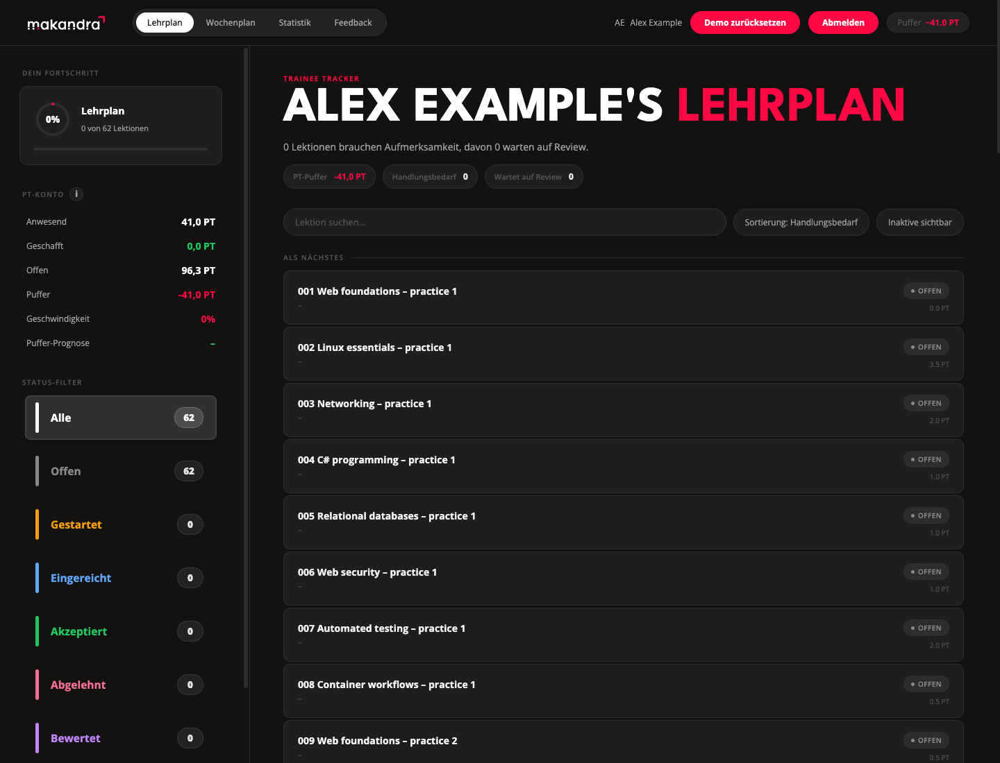
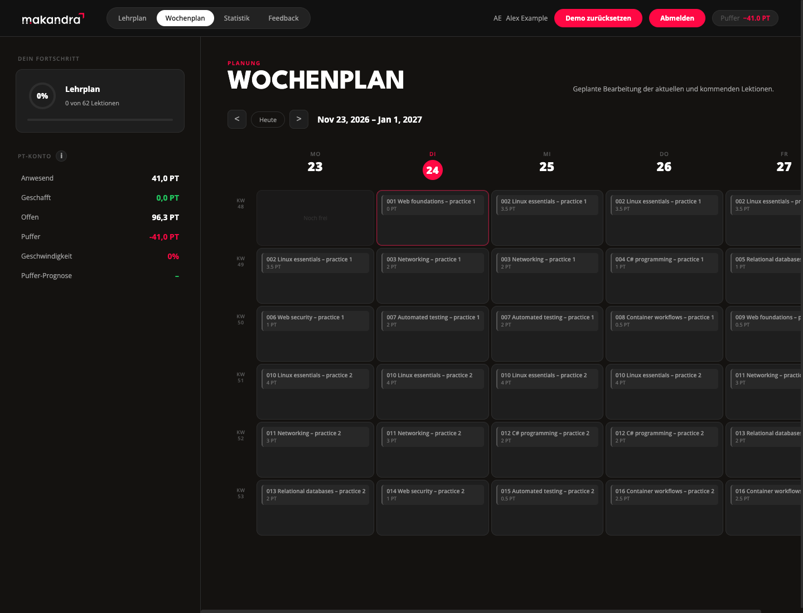
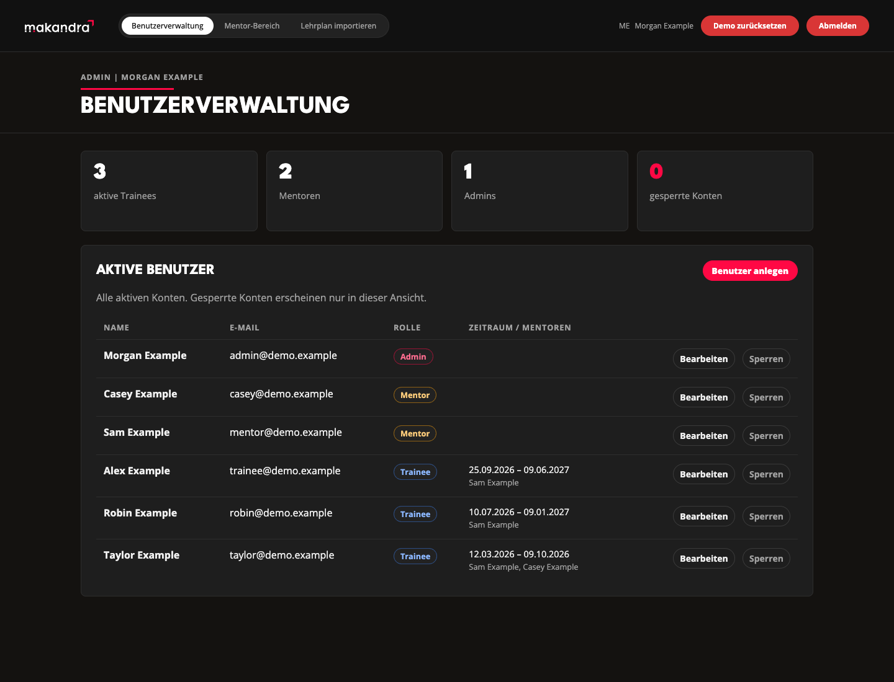

# Trainee Tracker

A role-based training management application for planning lessons, visualizing
learning progress and coordinating feedback between trainees, mentors and administrators.

**[Open the live demo →](https://trainee-tracker-demo.onrender.com/)**

Developed as a university team project in the Computer Science program at the
**University of Augsburg**, for **Makandra**. This portfolio deployment preserves
the original application's interface and business workflows with synthetic data.

## Live Demo

### Demo credentials

| Role | Email | Password |
| --- | --- | --- |
| Trainee | [trainee@demo.example](mailto:trainee@demo.example) | TraineeDemo!2026 |
| Mentor | [mentor@demo.example](mailto:mentor@demo.example) | MentorDemo!2026 |
| Administrator | [admin@demo.example](mailto:admin@demo.example) | AdminDemo!2026 |

All three roles can be explored interactively. Each visitor receives an isolated
demo environment, so changes stay within their own dataset. All demo data is synthetic.

Use **Demo zurücksetzen** to reset the environment at any time. Sessions expire
after two hours. Switching accounts in the same browser preserves the dataset,
allowing a complete trainee-to-mentor review workflow. Separate browser profiles
or private windows provide independent environments.

The first request may take longer while Render's free service wakes up.
Please enter fictional data only.

**Availability checked on 24 November 2026:** the live login page returned HTTP 200.
Interactive workflows have been tested locally; full live workflow verification
is pending.

## Screenshots

Captured from the local application using synthetic data.

### Personal dashboard

Searchable lessons, status filters and an overview of individual progress.

### Learning progress

Weighted completion, attendance, person-day metrics and status distribution.

### Weekly planning

A calendar view of planned lessons and their estimated effort.

### Mentor overview

Assigned trainees, progress indicators and recent feedback.

### User administration

Accounts, training dates and mentor assignments in the administrative dashboard.

## Features

### Trainee

- Personal dashboard with search, status filters and saved lesson ordering.
- Learning progress tracking through role-authorized lesson status transitions.
- Weekly planning and access to the curriculum and lesson details.
- Feedback overview with creation, editing and deletion of personal feedback.
- Attendance overview using locally generated training data.

### Mentor

- Overview of assigned trainees and switching between their dashboards.
- Progress monitoring, lesson review and role-authorized status changes.
- Feedback management for assigned trainees.
- Statistics, attendance metrics and weekly plans for selected trainees.
- Curriculum management through the JSON import available to mentors and administrators.

### Administrator

- User management with account creation, editing, closure and reopening.
- Mentor assignments and training-period management.
- Curriculum import with lesson creation, updates and deprecation of omitted entries.
- Administrative overview and access to trainee progress and feedback workflows.

## My Contribution

### Original university project

My main contributions were **dashboard development** and **learning progress
visualization**, presenting training status and progress information in a
structured interface for trainees and mentors. This work was carried out in
collaboration with the software development team.

### Portfolio preparation

The subsequent portfolio preparation includes:

- An interactive demo environment for all three application roles.
- Session-isolated SQLite databases with a reset workflow.
- Synthetic users, curriculum, feedback and attendance data.
- Docker-based deployment for Render Free.
- Security and deployment improvements covering authentication, authorization,
  antiforgery, login rate limiting and health checks.

## Tech Stack

| Category | Technology |
| --- | --- |
| Programming Language | C# |
| Backend | .NET 10, ASP.NET Core MVC |
| Frontend | Razor views, CSS, JavaScript, Fetch API |
| ORM | Entity Framework Core 10 |
| Database | SQLite |
| Authentication | ASP.NET Core cookie authentication, PBKDF2 password hashing |
| Testing | xUnit, Python HTTP integration tests, Chrome browser smoke tests |
| Containerization | Multi-stage Docker build with a non-root runtime |
| Hosting | Render Free |

## Architecture

The application follows the MVC pattern. Controllers handle page requests and
AJAX actions, Razor views render the interface, and application services contain
the training workflows. Repositories use Entity Framework Core for persistence.

    Browser → MVC controllers → Application services → Repositories → SQLite
                   ↓
               Razor views

At startup, the application migrates and seeds a template database. Each visitor
receives a separate copy, keeping administrative changes, imports and feedback
isolated from other visitors. Authentication cookies are bound to that environment.
Resetting creates a fresh environment; restarting the service invalidates existing sessions.

Each environment starts with **62 lessons, six users, four mentor assignments,
186 progress records and 56 feedback records**. Attendance and lesson content use
local synthetic replacements for the original company integrations.

## Getting Started

### Prerequisites

- .NET 10 SDK for local development.
- Git.
- Docker for the container setup.
- Python 3 for the HTTP integration tests.

The commands below use a Bash-compatible shell.

### Clone the portfolio branch

    git clone --branch portfolio-demo --single-branch https://github.com/Diyar68/TraineeTracker_University.git
    cd TraineeTracker_University

The clone checks out the deployment branch directly.

### Local development

Run from the repository root:

    Demo__Enabled=true ASPNETCORE_ENVIRONMENT=Development PORT=10000       dotnet run --no-launch-profile --project TraineeTracker

Open [http://localhost:10000](http://localhost:10000).

### Docker setup

    docker build -t trainee-tracker .
    docker run --rm -p 10000:10000       -e Demo__Enabled=true       -e ASPNETCORE_ENVIRONMENT=Development       -e PORT=10000       trainee-tracker

Development mode supports direct local HTTP browsing. Production authentication
cookies require HTTPS in the browser.

### Environment variables

| Variable | Local development | Render |
| --- | --- | --- |
| Demo__Enabled | true | true |
| ASPNETCORE_ENVIRONMENT | Development | Production |
| PORT | 10000 | 10000 |
| RENDER | Leave unset | Set to true automatically by Render |

The isolated deployment requires Demo__Enabled=true. It creates temporary
databases and never opens the original development database.

For Render, use the **portfolio-demo** branch, Docker runtime, repository-root
build context and **./Dockerfile**. Set the health check to **/healthz**.
Kestrel binds to **0.0.0.0:10000**, and Render handles TLS termination and
HTTP-to-HTTPS redirection.

## Testing

The latest local test run completed with **93 successful unit tests**.

    dotnet test TraineeTracker.UnitTests

With a disposable demo running locally:

    python3 tests/functional_http.py http://127.0.0.1:10000

The HTTP integration suite checks:

- Authentication for all three roles, authorization and antiforgery protection.
- User creation and editing, account closure and reopening.
- Lesson ordering, progress transitions and feedback creation, editing and deletion.
- Curriculum import, including lesson creation, updates and deprecation.
- Demo session isolation, authentication-cookie binding and dataset reset.
- Public and authenticated health checks.

For Production tests through a simulated local TLS edge, append --proxy. This
checks secure cookies while allowing the test client to transmit them over local HTTP.

Browser smoke tests cover the three logins and the dashboard, statistics,
weekly plan, mentor and administration views. Setup instructions are in
[tests/README.md](tests/README.md).

## Project Background & Credits

Trainee Tracker was developed collaboratively as a software project in the
Computer Science program at the **University of Augsburg**, for **Makandra**.

The original team contributed across dashboard development, authentication,
administration, curriculum handling, feedback, planning, testing and integration.
My contribution focuses on the dashboard and learning progress visualization.
Team authorship is retained in the source comments where present.

The original project is preserved on **integration-team-v2**. The interactive
portfolio deployment is maintained on **portfolio-demo**. Publication permissions,
including use of the retained company logos, have been confirmed by the project
owner. The repository currently defines no open-source license.
