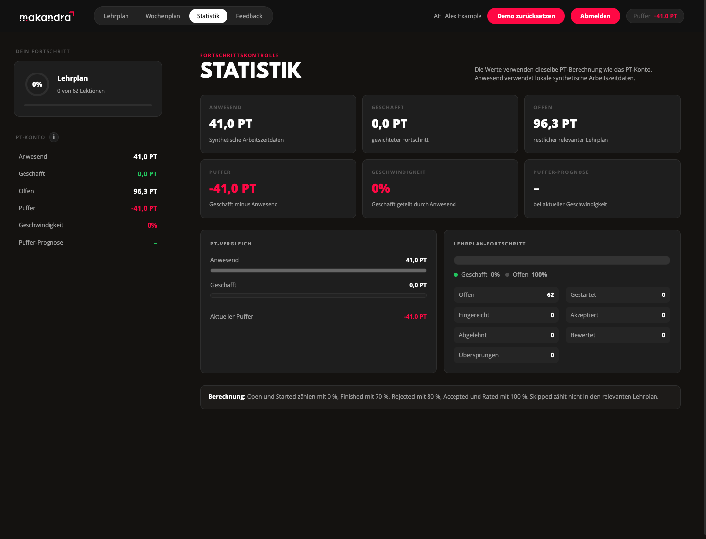
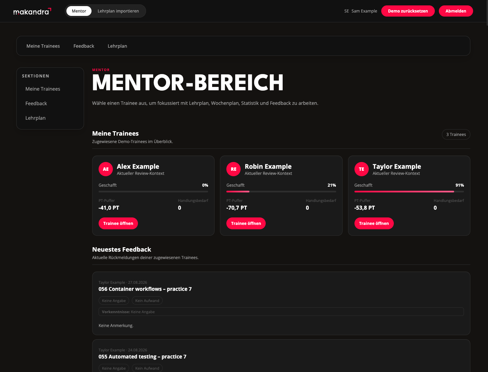

# Trainee Tracker

## Project Overview

Trainee Tracker is an ASP.NET Core MVC application for organizing a training
curriculum, following learning progress and coordinating feedback between
trainees and mentors. Administrators manage users and mentor assignments.

The application originated as a collaborative university software engineering
project. This deployment restores the original interface and business workflows
with isolated synthetic datasets for public exploration.

## Live Demo

**[Open Trainee Tracker](https://trainee-tracker-demo.onrender.com)**

The updated implementation has been verified locally. Verification of this
revision at the live URL is pending deployment.
Render Free may need time to wake the service after inactivity.

Each browser receives its own SQLite sandbox for up to two hours. Switching
accounts in the same browser preserves that sandbox, allowing you to complete
a trainee-to-mentor review workflow. Separate browser profiles or private windows
provide independent datasets. Use **Demo zurücksetzen** to restore the initial
dataset and return to login. Please enter fictional data only.

## Demo Credentials

| Role | Email | Password |
| --- | --- | --- |
| Trainee | trainee@demo.example | TraineeDemo!2026 |
| Mentor | mentor@demo.example | MentorDemo!2026 |
| Administrator | admin@demo.example | AdminDemo!2026 |

These public credentials exist only in the disposable demo datasets.
The administrator manages application users, assignments and curriculum in the
current sandbox. The application exposes no infrastructure management interface.

## Features

- Trainee dashboard with searchable lessons, status filters and individually persisted lesson ordering.
- Progress workflow for starting, submitting, reviewing, accepting, rejecting, rating and skipping lessons according to the original role rules.
- Weekly plan with the original calendar and lesson views.
- Progress visualization with weighted completion, status distribution, person-day metrics, attendance, buffer and projections.
- Mentor overview with assigned trainees, attention indicators, trainee selection and progress review.
- Feedback creation, editing and deletion with ownership and assignment checks.
- User administration with account creation, editing, closure, reopening, training dates and mentor assignments.
- Curriculum management through JSON import, including creation, updates and deprecation of omitted lessons.
- Demo reset that restores the full synthetic starting dataset.

The original project provides account closure/reopening and curriculum import.
It contains no standalone account hard-delete, lesson-editing CRUD screen or
export feature. Its available workflows are preserved.

## Screenshots

Captured from the restored local application with synthetic data.

### Trainee dashboard

### Learning progress

### Weekly plan

### Mentor overview

### User administration

## My Contribution

My main contribution to the original team project was developing the dashboard
and the visualization of learning progress. This included presenting training
status and progress information in a structured interface that helps trainees
and mentors understand the current learning state.

The application was built collaboratively. Other team members contributed across
authentication, administration, curriculum handling, feedback, planning, testing
and integration.

## Tech Stack

| Area | Technology |
| --- | --- |
| Application | C#, .NET 10, ASP.NET Core MVC |
| User interface | Razor views, CSS, JavaScript, Fetch API |
| Persistence | Entity Framework Core 10, SQLite |
| Authentication | ASP.NET Core cookies, PBKDF2 password hashing |
| Tests | xUnit, Python HTTP tests, Chrome browser smoke checks |
| Deployment | Multi-stage Docker build, non-root runtime, Render Free |

## Architecture

    Browser
      │ Razor views and AJAX requests
      ▼
    ASP.NET Core MVC
      ├── Authentication, role filters and antiforgery
      ├── Controllers and application services
      ├── Repositories and Entity Framework Core
      └── Separate SQLite database for this browser session

    Startup → migrate and seed template → copy template for each new sandbox

The schema, migration, repositories and business rules come from the original
university application. Each sandbox starts with **62 lessons, six users,
four mentor assignments, 186 progress records and 56 feedback records**.
There are three trainees, two mentors and one administrator. The seed retains
the original relationships, lesson order, estimates, deprecation flags and
progress distribution. Names, credentials, curriculum titles, links and feedback
text are synthetic. Training dates move relative to the current date while
preserving their original offsets and durations.

Attendance comes from a deterministic local service with weekdays, fictional
leave and half-days. No company API client is registered. Seed lesson links open local fictional
exercise pages in place of the external company card deck. Original styling and
branding assets are retained to restore the university application's appearance.

Sandbox IDs are random and protected with ASP.NET Core Data Protection.
Authentication cookies are bound to their sandbox. Requests within each sandbox
are serialized. Production cookies use Secure, HttpOnly and SameSite=Lax.
Mutations require antiforgery tokens, and login attempts are rate-limited.
Behind Render, the IP-based login limit may be shared by visitors.

Expired sandboxes are cleaned up on subsequent requests. The instance supports
up to 64 concurrent sandboxes and request bodies up to 2 MiB to bound resource
use on free hosting. A restart invalidates previous cookies and starts with
fresh data. No persistent volume or paid service is required.

## Getting Started

### Run locally

Install the .NET 10 SDK and run from the repository root:

    Demo__Enabled=true ASPNETCORE_ENVIRONMENT=Development PORT=10000 dotnet run --no-launch-profile --project TraineeTracker

Open [localhost:10000](http://localhost:10000). This isolated deployment requires
Demo__Enabled=true and never opens the original local development database.

### Docker

    docker build -t trainee-tracker .
    docker run --rm -p 10000:10000 -e Demo__Enabled=true -e ASPNETCORE_ENVIRONMENT=Development -e PORT=10000 trainee-tracker

Development is used here for local HTTP browsing. Production authentication
cookies require browser HTTPS.

### Render Free

Use the existing repository's portfolio-demo branch with Docker runtime,
repository-root build context and ./Dockerfile. Configure:

    Demo__Enabled=true
    ASPNETCORE_ENVIRONMENT=Production
    PORT=10000

Set the health check to /healthz. Kestrel binds to 0.0.0.0:10000. Render sets
RENDER=true and handles TLS termination and HTTP-to-HTTPS redirects at its edge.
The application does not trust arbitrary forwarded headers.

## Testing

    dotnet test TraineeTracker.UnitTests
    python3 tests/functional_http.py http://127.0.0.1:10000

The HTTP suite requires a disposable running demo. Add --proxy for Production
tests behind a simulated TLS edge. This checks Secure authentication cookies
while allowing the local test client to send them over HTTP.

The suite covers three logins, authorization, antiforgery, user creation and
editing, closure/reopening, lesson ordering, progress transitions, feedback CRUD,
curriculum import, independent datasets and reset. Tests use synthetic fixtures.
Browser smoke checks and screenshot capture are in tests/browser_smoke.mjs.
Setup and limitations are documented in tests/README.md.

## Project Background and Credits

This collaborative university project was originally developed with ASP.NET
Core MVC, C# and Entity Framework Core. The original is preserved on
integration-team-v2. Deployment adaptations are maintained on portfolio-demo.

Source comments retain team authorship where present. My personal contribution
focuses on the dashboard and learning-progress visualization. The deployment
adds synthetic data, local attendance fixtures, per-browser database isolation
and operational support for Render.

The project owner has confirmed the necessary publication permissions, including
use of the retained company logos. No
open-source license is defined in the repository. Credits and retained branding
do not imply endorsement by the university or companies represented in the UI.
